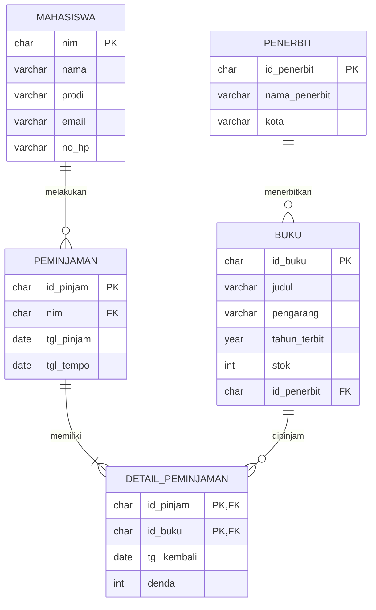

# Tugas Mandiri Modul 6: Perancangan ERD E-Library Kampus

- Nama : Ahmad Naufaldy Hasan
- NIM : D121241045

## 1. Deskripsi Kasus

Perpustakaan kampus membutuhkan basis data untuk sistem peminjaman buku. Data yang perlu dicatat adalah data mahasiswa sebagai peminjam, data buku, data penerbit, serta riwayat peminjaman dan pengembalian buku.

Beberapa aturan yang saya gunakan dalam perancangan:

1. Satu mahasiswa bisa melakukan banyak transaksi peminjaman.
2. Dalam satu transaksi, mahasiswa bisa meminjam lebih dari satu buku.
3. Satu buku bisa dipinjam berkali-kali di transaksi yang berbeda.
4. Satu penerbit bisa menerbitkan banyak buku, tetapi satu buku hanya punya satu penerbit.
5. Buku dalam satu transaksi bisa dikembalikan di tanggal yang berbeda, jadi tanggal kembali dan denda dicatat per buku.
6. Lama peminjaman 7 hari, denda keterlambatan Rp1.000 per hari per buku.

## 2. Desain ERD Logis

### 2.1 Entitas

| Entitas           | Keterangan                                                                    |
| ----------------- | ----------------------------------------------------------------------------- |
| Mahasiswa         | Data mahasiswa yang meminjam buku                                             |
| Buku              | Data koleksi buku perpustakaan                                                |
| Penerbit          | Data penerbit buku                                                            |
| Peminjaman        | Data transaksi peminjaman (siapa yang meminjam dan kapan)                     |
| Detail_Peminjaman | Data buku apa saja yang dipinjam dalam satu transaksi beserta pengembaliannya |

Entitas Transaksi Peminjaman saya pecah menjadi dua, yaitu Peminjaman dan Detail_Peminjaman. Alasannya karena hubungan antara transaksi dan buku adalah many-to-many (satu transaksi bisa banyak buku, satu buku bisa ada di banyak transaksi), sehingga perlu tabel penghubung.

### 2.2 Relasi

| Relasi                         | Kardinalitas | Penjelasan                                         |
| ------------------------------ | ------------ | -------------------------------------------------- |
| Mahasiswa - Peminjaman         | 1 : N        | Satu mahasiswa dapat melakukan banyak peminjaman   |
| Peminjaman - Detail_Peminjaman | 1 : N        | Satu peminjaman berisi satu atau lebih buku        |
| Buku - Detail_Peminjaman       | 1 : N        | Satu buku dapat muncul di banyak detail peminjaman |
| Penerbit - Buku                | 1 : N        | Satu penerbit menerbitkan banyak buku              |

## 3. Atribut, Primary Key, dan Foreign Key

| Entitas           | Atribut                                                    | Primary Key         | Foreign Key        |
| ----------------- | ---------------------------------------------------------- | ------------------- | ------------------ |
| Mahasiswa         | nim, nama, prodi, email, no_hp                             | nim                 | -                  |
| Penerbit          | id_penerbit, nama_penerbit, kota                           | id_penerbit         | -                  |
| Buku              | id_buku, judul, pengarang, tahun_terbit, stok, id_penerbit | id_buku             | id_penerbit        |
| Peminjaman        | id_pinjam, nim, tgl_pinjam, tgl_tempo                      | id_pinjam           | nim                |
| Detail_Peminjaman | id_pinjam, id_buku, tgl_kembali, denda                     | id_pinjam + id_buku | id_pinjam, id_buku |

Keterangan: tgl_tempo adalah batas tanggal pengembalian. Primary key Detail_Peminjaman merupakan gabungan (composite key) dari id_pinjam dan id_buku.

## 4. Simulasi Normalisasi

Agar tabel tidak terlalu lebar, pada simulasi normalisasi ini hanya ditampilkan atribut utama. Atribut pelengkap seperti email, no_hp, pengarang, tahun_terbit, stok, kota, dan tgl_tempo ditambahkan pada rancangan tabel akhir.

### 4.1 Unnormalized Form (UNF)

Data awal diambil dari catatan peminjaman manual. Satu transaksi bisa berisi lebih dari satu buku, sehingga terdapat data yang berulang (repeating group) seperti pada transaksi PJ001.

| id_pinjam | tgl_pinjam | nim        | nama  | prodi       | id_buku | judul             | id_penerbit | penerbit | tgl_kembali | denda |
| --------- | ---------- | ---------- | ----- | ----------- | ------- | ----------------- | ----------- | -------- | ----------- | ----- |
| PJ001     | 2026-09-01 | D121241001 | Rina  | Informatika | BK01    | Basis Data        | PB01        | Andi     | 2026-09-07  | 0     |
|           |            |            |       |             | BK02    | Algoritma         | PB02        | Erlangga | 2026-09-10  | 2000  |
| PJ002     | 2026-09-03 | D121241002 | Fajar | Informatika | BK01    | Basis Data        | PB01        | Andi     | 2026-09-09  | 0     |
| PJ003     | 2026-09-05 | D041241010 | Dewi  | Elektro     | BK03    | Jaringan Komputer | PB03        | Gramedia | -           | -     |

Masalah pada tabel UNF ini adalah adanya baris yang kosong pada kolom transaksi karena satu transaksi memuat dua buku. Selain itu data buku dan penerbit ditulis berulang-ulang.

### 4.2 First Normal Form (1NF)

Syarat 1NF adalah setiap kolom bernilai atomik dan tidak ada repeating group. Caranya dengan mengisi baris yang kosong sehingga setiap baris berisi satu buku dalam satu transaksi. Primary key tabel menjadi gabungan id_pinjam dan id_buku.

| id_pinjam | id_buku | tgl_pinjam | nim        | nama  | prodi       | judul             | id_penerbit | penerbit | tgl_kembali | denda |
| --------- | ------- | ---------- | ---------- | ----- | ----------- | ----------------- | ----------- | -------- | ----------- | ----- |
| PJ001     | BK01    | 2026-09-01 | D121241001 | Rina  | Informatika | Basis Data        | PB01        | Andi     | 2026-09-07  | 0     |
| PJ001     | BK02    | 2026-09-01 | D121241001 | Rina  | Informatika | Algoritma         | PB02        | Erlangga | 2026-09-10  | 2000  |
| PJ002     | BK01    | 2026-09-03 | D121241002 | Fajar | Informatika | Basis Data        | PB01        | Andi     | 2026-09-09  | 0     |
| PJ003     | BK03    | 2026-09-05 | D041241010 | Dewi  | Elektro     | Jaringan Komputer | PB03        | Gramedia | NULL        | 0     |

Tabel sudah 1NF, tetapi masih ada masalah. Contohnya, data Rina ditulis dua kali, dan jika transaksi PJ003 dihapus maka data buku Jaringan Komputer dan penerbit Gramedia ikut hilang.

### 4.3 Second Normal Form (2NF)

Syarat 2NF adalah sudah 1NF dan tidak ada ketergantungan parsial, yaitu atribut yang hanya bergantung pada sebagian primary key.

Ketergantungan fungsional yang ditemukan:

- id_pinjam → tgl_pinjam, nim, nama, prodi (parsial)
- id_buku → judul, id_penerbit, penerbit (parsial)
- id_pinjam, id_buku → tgl_kembali, denda (penuh)

Maka tabel dipecah menjadi tiga.

Tabel Peminjaman

| id_pinjam | tgl_pinjam | nim        | nama  | prodi       |
| --------- | ---------- | ---------- | ----- | ----------- |
| PJ001     | 2026-09-01 | D121241001 | Rina  | Informatika |
| PJ002     | 2026-09-03 | D121241002 | Fajar | Informatika |
| PJ003     | 2026-09-05 | D041241010 | Dewi  | Elektro     |

Tabel Buku

| id_buku | judul             | id_penerbit | penerbit |
| ------- | ----------------- | ----------- | -------- |
| BK01    | Basis Data        | PB01        | Andi     |
| BK02    | Algoritma         | PB02        | Erlangga |
| BK03    | Jaringan Komputer | PB03        | Gramedia |

Tabel Detail_Peminjaman

| id_pinjam | id_buku | tgl_kembali | denda |
| --------- | ------- | ----------- | ----- |
| PJ001     | BK01    | 2026-09-07  | 0     |
| PJ001     | BK02    | 2026-09-10  | 2000  |
| PJ002     | BK01    | 2026-09-09  | 0     |
| PJ003     | BK03    | NULL        | 0     |

### 4.4 Third Normal Form (3NF)

Syarat 3NF adalah sudah 2NF dan tidak ada ketergantungan transitif, yaitu atribut bukan kunci yang bergantung pada atribut bukan kunci lainnya.

Ketergantungan transitif yang ditemukan:

- Pada tabel Peminjaman: id_pinjam → nim → nama, prodi. Data mahasiswa dipisah menjadi tabel Mahasiswa.
- Pada tabel Buku: id_buku → id_penerbit → penerbit. Data penerbit dipisah menjadi tabel Penerbit.

Tabel Mahasiswa

| nim        | nama  | prodi       |
| ---------- | ----- | ----------- |
| D121241001 | Rina  | Informatika |
| D121241002 | Fajar | Informatika |
| D041241010 | Dewi  | Elektro     |

Tabel Peminjaman

| id_pinjam | nim        | tgl_pinjam |
| --------- | ---------- | ---------- |
| PJ001     | D121241001 | 2026-09-01 |
| PJ002     | D121241002 | 2026-09-03 |
| PJ003     | D041241010 | 2026-09-05 |

Tabel Penerbit

| id_penerbit | nama_penerbit |
| ----------- | ------------- |
| PB01        | Andi          |
| PB02        | Erlangga      |
| PB03        | Gramedia      |

Tabel Buku

| id_buku | judul             | id_penerbit |
| ------- | ----------------- | ----------- |
| BK01    | Basis Data        | PB01        |
| BK02    | Algoritma         | PB02        |
| BK03    | Jaringan Komputer | PB03        |

Tabel Detail_Peminjaman

| id_pinjam | id_buku | tgl_kembali | denda |
| --------- | ------- | ----------- | ----- |
| PJ001     | BK01    | 2026-09-07  | 0     |
| PJ001     | BK02    | 2026-09-10  | 2000  |
| PJ002     | BK01    | 2026-09-09  | 0     |
| PJ003     | BK03    | NULL        | 0     |

Hasil akhir normalisasi terdiri dari lima tabel. Setelah 3NF, data mahasiswa, buku, dan penerbit hanya disimpan satu kali, sehingga perubahan data cukup dilakukan di satu tempat dan penghapusan transaksi tidak menghilangkan data buku.

## 5. Rancangan Tabel Akhir

Tabel mahasiswa

| Kolom | Tipe Data    | Keterangan      |
| ----- | ------------ | --------------- |
| nim   | CHAR(10)     | Primary Key     |
| nama  | VARCHAR(100) | Nama mahasiswa  |
| prodi | VARCHAR(50)  | Program studi   |
| email | VARCHAR(100) | Email mahasiswa |
| no_hp | VARCHAR(15)  | Nomor HP        |

Tabel penerbit

| Kolom         | Tipe Data    | Keterangan         |
| ------------- | ------------ | ------------------ |
| id_penerbit   | CHAR(4)      | Primary Key        |
| nama_penerbit | VARCHAR(100) | Nama penerbit      |
| kota          | VARCHAR(50)  | Kota asal penerbit |

Tabel buku

| Kolom        | Tipe Data    | Keterangan                |
| ------------ | ------------ | ------------------------- |
| id_buku      | CHAR(4)      | Primary Key               |
| judul        | VARCHAR(150) | Judul buku                |
| pengarang    | VARCHAR(100) | Nama pengarang            |
| tahun_terbit | YEAR         | Tahun terbit              |
| stok         | INT          | Jumlah buku yang tersedia |
| id_penerbit  | CHAR(4)      | Foreign Key ke penerbit   |

Tabel peminjaman

| Kolom      | Tipe Data | Keterangan                 |
| ---------- | --------- | -------------------------- |
| id_pinjam  | CHAR(5)   | Primary Key                |
| nim        | CHAR(10)  | Foreign Key ke mahasiswa   |
| tgl_pinjam | DATE      | Tanggal peminjaman         |
| tgl_tempo  | DATE      | Batas tanggal pengembalian |

Tabel detail_peminjaman

| Kolom       | Tipe Data | Keterangan                                  |
| ----------- | --------- | ------------------------------------------- |
| id_pinjam   | CHAR(5)   | Primary Key, Foreign Key ke peminjaman      |
| id_buku     | CHAR(4)   | Primary Key, Foreign Key ke buku            |
| tgl_kembali | DATE      | Tanggal buku dikembalikan (NULL jika belum) |
| denda       | INT       | Denda keterlambatan dalam rupiah            |

## 6. Visualisasi Relasi

### 6.1 Diagram ERD (Mermaid)



### 6.2 Diagram Teks Relasi Kunci

```text
MAHASISWA (nim)
    |
    | 1 : N
    v
PEMINJAMAN (id_pinjam, nim)
    |
    | 1 : N
    v
DETAIL_PEMINJAMAN (id_pinjam, id_buku)
    ^
    | N : 1
    |
BUKU (id_buku, id_penerbit)
    ^
    | N : 1
    |
PENERBIT (id_penerbit)
```

## 7. Kesimpulan

Basis data E-Library dirancang dengan lima tabel, yaitu mahasiswa, penerbit, buku, peminjaman, dan detail_peminjaman. Tabel detail_peminjaman digunakan untuk menghubungkan peminjaman dan buku yang memiliki relasi many-to-many. Melalui normalisasi sampai 3NF, data tidak lagi ditulis berulang dan anomali saat menambah, mengubah, atau menghapus data dapat dihindari.
